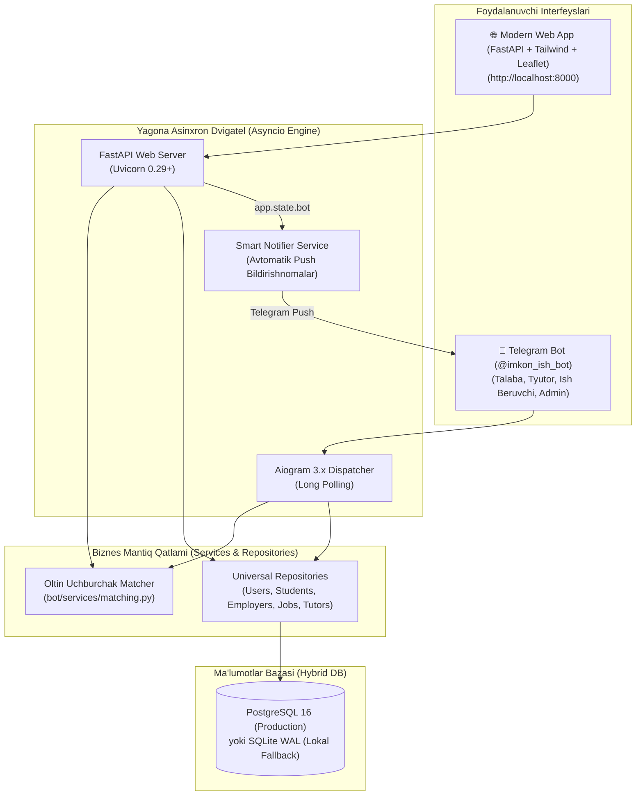

# 🌟 IMKON — UrDU Talabalar Bandligi, Davlat Amaliyoti va Kontrakt Granti Ekotizimi

<div align="center">

[](https://www.python.org/)
[](https://fastapi.tiangolo.com/)
[-2CA5E0?logo=telegram&logoColor=white)](https://aiogram.dev/)
[](https://leafletjs.com/)
[](https://tailwindcss.com/)
[](https://www.postgresql.org/)
[](LICENSE)

**Urganch Davlat Universiteti (UrDU) Talabalar Bandligi, Rasmiy Davlat Amaliyoti va OTM Tyutorlik Monitoring Tizimi**

[🤖 Rasmiy Telegram Bot: @imkon_ish_bot](https://t.me/imkon_ish_bot) • [🌐 Jonli Veb-Platforma: http://localhost:8000](http://localhost:8000) • [📂 GitHub Repozitoriy](https://github.com/Seymonbek/Hackathon_Urdu.git)

</div>

---

## 📑 Mundarija

1. [📌 Loyiha Haqida va Muammo/Yechim](#-loyiha-haqida-va-muammoyechim)
2. [📐 "Oltin Uchburchak" Aqlli Saralash Algoritmi](#--oltin-uchburchak--aqlli-saralash-algoritmi)
3. [🏛 Tizim Arxitekturasi va Sinxron Ishlash Mexanizmi](#-tizim-arxitekturasi-va-sinxron-ishlash-mexanizmi)
4. [👥 Asosiy Foydalanuvchi Rollari va Panellar](#-asosiy-foydalanuvchi-rollari-va-panellar)
   - [🎓 1. Talaba Paneli](#1--talaba-paneli)
   - [🏢 2. Ish Beruvchi va Davlat Organi Paneli](#2--ish-beruvchi-va-davlat-organi-paneli)
   - [🧑‍🏫 3. OTM Tyutori Paneli (WOW-Funksiya)](#3--otm-tyutori-paneli-wow-funksiya)
   - [👑 4. Administrator va Rektorat Boshqaruvi](#4--administrator-va-rektorat-boshqaruvi)
5. [⚖️ Qonunchilik va Ijtimoiy-Iqtisodiy Himoya](#️-qonunchilik-va-ijtimoiy-iqtisodiy-himoya)
6. [🌐 Zamonaviy Veb-Platforma va REST API Hujjatlari](#-zamonaviy-veb-platforma-va-rest-api-hujjatlari)
7. [📍 Urganch Shahridagi Real Korxonalar va Vakansiyalar](#-urganch-shahridagi-real-korxonalar-va-vakansiyalar)
8. [📂 Loyiha Strukturasi (Clean Architecture)](#-loyiha-strukturasi-clean-architecture)
9. [⚙️ O'rnatish va Ishga Tushirish Qo'llanmasi](#️-ornatish-va-ishga-tushirish-qollanmasi)
10. [🧪 Avtomatlashtirilgan Testlar](#-avtomatlashtirilgan-testlar)
11. [🏆 Hakamlar Uchun Tezkor Sinov Qo'llanmasi](#-hakamlar-uchun-tezkor-sinov-qollanmasi)

---

## 📌 Loyiha Haqida va Muammo/Yechim

### Muammo:
1. **Dars va ish to'qnashuvi:** UrDU talabalarining 86% qismi darsdan bo'sh vaqtida ishlashni xohlaydi, ammo mavjud ish e'lonlari (Olx, HeadHunter, Telegram guruhlar) dars jadvalini hisobga olmaydi. Natijada dars qoldirish va past o'zlashtirish kelib chiqadi.
2. **Nazoratning yo'qligi:** Universitet dekanati va tyutorlari qaysi talaba qayerda ishlayotgani yoki amaliyot o'tayotganidan bexabar.
3. **Sessiya paytida chalg'ish:** Imtihonlar paytida ham talabalar ish qidirish yoki yarim stavkali ishlarda charchash oqibatida sessiyadan yiqiladi.
4. **Xavfli va norasmiy ishlar:** 18 yoshga to'lmagan talabalar tungi smenalarga jalb qilinishi, TTJ (Talabalar turar joyi) 22:00 ichki tartibining buzilishi va norasmiy mehnat.

### Yechim: **IMKON Ekotizimi**
**Imkon** — bitta yagona `asyncio` jarayonida sinxron ishlovchi **Aiogram 3.x Telegram Boti** va **Zamonaviy FastAPI Veb-Platformasidan** iborat universal ekotizim:
- Talabaning OTM mutaxassisligi, dars jadvali, GPA bali va turar joyiga 100% mos ishlarni **"Oltin Uchburchak"** algoritmi orqali saralaydi.
- Davlat organlarida (Adliya, Sud, Shifoxona, IT Park) rasmiy amaliyot va amaliyot kundaligi yuritishni ta'minlaydi.
- Korxonalar tomonidan iqtidorli talabaning **yillik to'lov-kontrakti to'lab beriladigan grant vakansiyalarini** taqdim etadi.
- Tyutorlarga bitta tugma bilan butun guruhga **20 kunlik Sessiya Qulfi** o'rnatish va talabalarga Telegram push ogohlantirish yuborish imkonini beradi.

---

## 📐 "Oltin Uchburchak" Aqlli Saralash Algoritmi

Har bir talaba uchun vakansiyalar **0 dan 100 ballgacha** bo'lgan moslik indeksi bo'yicha tahlil qilinadi:

$$\text{Moslik Bali} = S_{\text{mutaxassislik}} + S_{\text{vaqt}} + S_{\text{masofa}} + S_{\text{bonus}}$$

| Mezon | Maksimal Ball | Algoritm Tavsifi |
|---|---|---|
| **🎓 Mutaxassislik & Soha** | **35 ball** | Semantik klasterlash (IT, Law, Medical, Finance, Pedagogy, Media). Aniq moslikka 35 ball, umumiy sohaga 25 ball. |
| **⏰ Dars Jadvali & Bo'sh Vaqt** | **25 ball** | Dars jadvali bilan to'qnashuvni tahlil qilish. Darsdan keyin kamida 15-30 daqiqa yo'l buferi mavjud bo'lsa to'liq 25 ball beriladi. |
| **📍 Masofa & Geolokatsiya** | **25 ball** | Haversine formulasi asosida talaba turar joyi (TTJ / ijara uy) va ish joyi orasidagi masofani hisoblash: 1 km gacha — 25 ball; 3 km gacha — 20 ball; 5 km gacha — 15 ball. |
| **💎 Bonus & Rag'batlantirish** | **15 ball** | 100% Kontrakt to'lab beriladigan grant vakansiyalari (+10 ball), Davlat organi amaliyoti (+5 ball), GPA 4.5+ talabalar uchun imtiyoz. |

### 🛡 Qattiq Filtrlar (Hard Restrictions):
1. **Sessiya Qulfi:** Agar tyutor yoki talabaning o'zi sessiya rejimini yoqqan bo'lsa, barcha arizalar bloklanadi.
2. **Mehnat Kodeksi 411-moddasi (18+ yosh):** 18 yoshga to'lmagan talabalarga tungi smenalar (22:00 - 06:00) ko'rsatilmaydi va ariza topshirish bloklanadi.
3. **TTJ 22:00 Ichki Tartibi:** Kechki smena 21:00 dan oshsa, tizim talabani ogohlantiradi va TTJ komendanti bilan kelishishni talab qiladi.

---

## 🏛 Tizim Arxitekturasi va Sinxron Ishlash Mexanizmi

Bot va Web ilova bitta umumiy ma'lumotlar bazasi (`imkon.db` / PostgreSQL) va bitta `aiogram.Bot` instansiyasidan foydalanadi. Web orqali ariza topshirilsa yoki vakansiya qo'shilsa, darhol Telegram botga push-xabar boradi:



---

## 👥 Asosiy Foydalanuvchi Rollari va Panellar

### 1. 🎓 Talaba Paneli
* **"Oltin Uchburchak" Vakansiyalar Karuseli:** Barcha mos ishlar bir xabarda `[ ⬅️ Oldingi ]` va `[ Keyingi ➡️ ]` inline tugmalari bilan sahifalab ko'rsatiladi. Xabarlar takrorlanmaydi va ortiqcha spam qilinmaydi.
* **Toifalar bo'yicha saralash:** `Pullik Part-Time Ishlar`, `Davlat Amaliyotlari`, `100% Kontrakt To'lanadigan Grantlar`.
* **Smart Rezyume (CV Card):** OTM, mutaxassislik, kurs, GPA, chet tillari va amaliyot natijalari jamlangan professional kartochka.
* **Elektron Amaliyot Kundaligi:** Davlat organida o'tgan kunlik soatlarni kiritish va rahbar tomonidan tasdiqlanishi.
* **Sessiya Rejimi (Pauza):** Imtihonlar davrida talabaning o'zi barcha ish takliflarini vaqtincha to'xtatib qo'yishi mumkin.
* **14 kunlik Ishdan Bo'shash Arizasi Generatori:** Mehnat kodeksining 160-moddasi bo'yicha tayyor rasmiy ariza matnini generatsiya qiladi.

### 2. 🏢 Ish Beruvchi va Davlat Organi Paneli
* **Tezkor E'lon Joylash:** Tijoriy part-time vakansiya, davlat amaliyoti yoki kontrakt granti joylash. E'lon joylanishi bilan barcha mos talabalarga avtomatik push boradi!
* **Arizalar Qabul Qutisi (Inbox):** Nomzodning GPA bali, dars jadvali va yashash masofasini ko'rib, bir tugma bilan `[ ✅ Qabul qilish ]`, `[ ⏳ Zaxiraga olish ]` yoki `[ ❌ Rad etish ]`.
* **Bugungi Xodimlar Nazorati:** Ishga kelganlarni tasdiqlash yoki `[ ⚠️ Kelmadi (No-show) ]` belgilash.

### 3. 🧑‍🏫 OTM Tyutori Paneli (WOW-Funksiya)
* **Guruh Monitoring Dossiesi:** Guruhdagi har bir talabaning GPA bali, qayerda ishlayotgani yoki amaliyot o'tayotgani, korxona manzili va ish beruvchi telefonini ko'rish.
* **🔒 20 Kunlik Guruh Sessiya Qulfi:** Bitta tugma orqali butun guruhga imtihonlar qulfi o'rnatiladi:
  - Guruhdagi barcha talabalarning Telegramiga zudlik bilan rasmiy ogohlantirish boradi.
  - Talabalar yangi ishlarga ariza topshira olmaydi (Tizim 403 xato beradi).
* **🔓 Sessiya Qulfini Ochish:** Imtihonlar tugagach, qulf yechiladi va talabalar yana erkin ish qidirishi mumkin.
* **Rasmiy Dekanat Hisoboti (CSV / Excel):** UTF-8 BOM formatida guruhning to'liq bandlik hisobotini yuklab olish.

### 4. 👑 Administrator va Rektorat Boshqaruvi
* **Ish beruvchilarni verifikatsiyalash:** Ishonchli korxonalarga tasdiqlangan (✔️ Verified) maqomi berish.
* **Tyutorlarni tayinlash:** OTM o'qituvchilariga tyutorlik rolini biriktirish va guruhlarni boshqarish.
* **Universal Rol Sinovi:** `/switch_role` yoki `/role` orqali hakamlar va moderatorlar istalgan rolni (Talaba, Ish beruvchi, Tyutor, Admin) darhol sinab ko'rishlari mumkin.

---

## ⚖️ Qonunchilik va Ijtimoiy-Iqtisodiy Himoya

Tizim O'zbekiston Respublikasi amaldagi qonunchiligi bilan to'liq uyg'unlashtirilgan:

```
┌────────────────────────────────────────────────────────────────────────┐
│                      HUQUQIY VA MOLIYAVIY ASOSLAR                      │
├────────────────────────────────┬───────────────────────────────────────┤
│ 📜 Mehnat Kodeksi 160-moddasi │ Talaba xohishiga ko'ra 14 kun oldin  │
│    (Bo'shash kafolati)         │ ogohlantirish arizasi generatsiyasi   │
├────────────────────────────────┼───────────────────────────────────────┤
│ 🌙 Mehnat Kodeksi 411-moddasi │ 18 yoshga to'lmagan talabalarni tungi │
│    (18+ Yosh himoyasi)         │ smenalardan (22:00-06:00) bloklash    │
├────────────────────────────────┼───────────────────────────────────────┤
│ 🏢 Soliq Kodeksi 378-moddasi   │ Talaba kontraktini to'lagan korxona   │
│    (Soliq imtiyozi)            │ foyda solig'idan (15%) ozod etiladi   │
├────────────────────────────────┼───────────────────────────────────────┤
│ 🏠 TTJ Ichki Qoidalari        │ Soat 22:00 dan keyingi smenalarga OTM │
│    (Xavfsizlik)                │ va komendant kelishuvi talabi         │
└────────────────────────────────┴───────────────────────────────────────┘
```

> **Soliq Imtiyozi Misoli (Soliq K. 378-moddasi):**
> Agar korxona UrDU talabasining yillik **12,000,000 so'm** to'lov-kontraktini qoplab bersa:
> - Foyda solig'i (15%) bo'yicha tejamkorlik: **1,800,000 so'm**
> - JShODS (12%) bo'yicha tejamkorlik: **1,440,000 so'm**
> - **Jami korxona iqtisodi: 3,240,000 so'm!** Veb-saytimizdagi interaktiv kalkulyatorda bu jonli hisoblanadi.

---

## 🌐 Zamonaviy Veb-Platforma va REST API Hujjatlari

Platforma zamonaviy Glassmorphism dizaynida qurilgan bo'lib, mobil va kompyuterga 100% moslashuvchan.

### Veb-sayt bo'limlari:
1. **Talaba va "Oltin Uchburchak" Birjasi:** Jonli statistika, mutaxassislik/kurs/GPA filtrlari, Leaflet.js xaritasi, 1-klikda ariza topshirish, 14 kunlik bo'shash arizasi generatsiyasi.
2. **Ish Beruvchi Kabineti:** Yangi vakansiya/amaliyot joylash, Soliq kodeksi 378-modda imtiyoz kalkulyatori.
3. **OTM Tyutori & Sessiya Qulfi (WOW):** Guruh talabalari jadvali, 20 kunlik qulfni yoqish/o'chirish pulti.
4. **Xakaton Tahlili & Rektorat:** Urganchdagi real korxonalar jadvali, so'rovnoma progress-barlari, biznes-model va monetizatsiya rejalari, CSV to'liq baza yuklab olish.

### REST API Endpoints:

| Method | Endpoint | Tavsif | Parametrlar / Body |
|---|---|---|---|
| `GET` | `/` | Web ilova bosh sahifasi ([index.html](bot/web/index.html)) | — |
| `GET` | `/api/stats` | Tizimdagi real-vaqt statistikasi | `total_jobs`, `employed`, `internships`, `grants`, `apps` |
| `GET` | `/api/jobs` | Moslik balli bilan saralangan ochiq ishlar | `category`, `listing_type`, `major`, `course`, `gpa`, `max_distance_km` |
| `POST` | `/api/jobs` | Vebdan yangi vakansiya qo'shish & Push yuborish | `company_name`, `title`, `pay_amount`, `start_time`, `end_time`, `target_majors` |
| `POST` | `/api/apply` | 1-Klikda vakansiyaga ariza topshirish | `job_id`, `full_name`, `phone_number`, `faculty`, `major`, `course`, `gpa_score`, `tg_id` |
| `GET` | `/api/tutor/dashboard` | Tyutor ma'lumotlari va guruh talabalari ro'yxati | Sessiya qulfi holati, GPA, korxona nomlari |
| `POST` | `/api/tutor/exam-lock` | Tyutor tomonidan sessiya qulfini boshqarish | `action: "lock" \| "unlock"`, `days: 20` |
| `GET` | `/api/export/csv` | Rektorat va dekanat uchun to'liq CSV hisobot | UTF-8 BOM (`utf-8-sig`) streaming |

---

## 📍 Urganch Shahridagi Real Korxonalar va Vakansiyalar

Platforma bazasiga Urganch shahridagi real faoliyat yurituvchi tashkilotlar va davlat idoralari kiritilgan:

| Tashkilot Nomi | Turi | Lavozim | Maosh / Shart | Ish Vaqti |
|---|---|---|---|---|
| **"Inson" Ijtimoiy Xizmatlar Markazi** | Davlat Organi | Kompleks ijtimoiy xodim | 5,440,000 so'm + **100% Kontrakt** | 09:00 - 18:00 |
| **The United Team Logistika** | IT Park Urganch | Logistika Dispetcheri | $300 - $1,500/oy | 17:00 - 03:00 |
| **"MITTIVOY" Mediapark Filiali** | Tijoriy | Sotuvchi-konsultant | 3,500,000 - 4,500,000 so'm | 14:00 - 23:00 |
| **HDP O'quv Markazi & Omon School** | Ta'lim | Call Operator | 4,000,000+ so'm | 14:00 - 19:30 |
| **"Bunyod" Gamburg 1-filiali** | HoReCa | Ofitsiant (2-smena) | 110,000 so'm/kun | 14:00 - 21:00 |
| **Mehmon uyi oilaviy hosteli** | Turizm | Hostel boshqaruvchisi | 100,000 so'm/kun | 08:00 - 18:00 |
| **Urganch Shahar Adliya Boshqarmasi** | Davlat Organi | Yuridik amaliyotchi | Rasmiy sertifikat + Davlat staji | 14:00 - 18:00 |
| **Xorazm Viloyat Ko'p Tarmoqli Shifoxonasi** | Sog'liqni Saqlash | Hamshira/Feldsher amaliyoti | Rasmiy amaliyot daftarchasi | 14:00 - 18:00 |
| **ATB "Kapitalbank" Urganch Filiali** | Bank/Moliya | Bank amaliyotchisi | Karyera starti + Grant tavsiyasi | 14:00 - 18:00 |

---

## 📂 Loyiha Strukturasi (Clean Architecture)

```
Hakaton/
├── bot/
│   ├── main.py                     # Asosiy kirish nuqtasi (Aiogram + FastAPI yagona jarayonda)
│   ├── config.py                   # Pydantic v2 sozlamalari (.env)
│   ├── assets/                     # Rasm va logotiplar (UrDU, Imkon)
│   ├── core/                       # Yadro modullari
│   │   ├── constants.py            # Rollar, kategoriyalar, statuslar
│   │   ├── roles.py                # Rol tekshirish middleware va RoleFilter
│   │   ├── middleware.py           # Throttling, xatolar ushlagich
│   │   ├── keyboards.py            # Reply va Inline tugmalar generatori
│   │   └── i18n/                   # Ko'p tillilik (uz, ru, en)
│   ├── db/                         # Ma'lumotlar bazasi qatlami
│   │   ├── connection.py           # PostgreSQL + SQLite WAL gibrid ulanish
│   │   ├── schema_sqlite.sql       # SQLite sxemasi
│   │   ├── schema_pg.sql           # PostgreSQL sxemasi
│   │   ├── seed.py                 # UrDU va Urganch korxonalari boshlang'ich ma'lumotlari
│   │   └── repositories/           # Repozitoriy qatlami
│   │       ├── users_repo.py
│   │       ├── students_repo.py
│   │       ├── employers_repo.py
│   │       ├── jobs_repo.py
│   │       ├── applications_repo.py
│   │       └── tutors_repo.py
│   ├── services/                   # Biznes mantiq servislari
│   │   ├── matching.py             # "Oltin Uchburchak" 100 ballik matching
│   │   ├── smart_notifier.py       # Telegram push-xabarnomalar servisi
│   │   ├── admin_notifier.py       # Adminga tezkor bildirishnomalar
│   │   ├── geo.py                  # Haversine masofa hisoblagich
│   │   └── schedule.py             # Dars jadvali to'qnashuvini tekshiruvchi
│   ├── panels/                     # Bot boshqaruv panellari
│   │   ├── student/                # Talaba interfeysi (feed, amaliyot, rezyume, arizalar)
│   │   ├── employer/               # Ish beruvchi interfeysi (vakansiyalar, arizalar, ishchilar)
│   │   ├── tutor/                  # Tyutor interfeysi (guruh nazorati, sessiya qulfi)
│   │   └── admin/                  # Admin boshqaruvi (verifikatsiya, statistika, eksport)
│   └── web/                        # Zamonaviy Veb-Platforma
│       ├── api.py                  # FastAPI REST API
│       └── index.html              # TailwindCSS + Leaflet interaktiv frontend
├── tests/                          # Avtomatlashtirilgan testlar
│   ├── test_web_api.py             # 10 ta API va integratsiya testi
│   ├── test_matching.py            # Saralash algoritmi testlari
│   └── test_tutor_role.py          # Tyutor qulfi testlari
├── imkon.db                        # Jonli SQLite WAL bazasi
├── requirements.txt                # Kutubxonalar ro'yxati
├── docker-compose.yml              # Konteynerlashtirish sozlamalari
└── README.md                       # Ushbu to'liq hujjat
```

---

## ⚙️ O'rnatish va Ishga Tushirish Qo'llanmasi

### 1. Repozitoriyani klonlash
```bash
git clone https://github.com/Seymonbek/Hackathon_Urdu.git
cd Hackathon_Urdu
```

### 2. Virtual muhitni yaratish va faollashtirish
**Windows:**
```powershell
python -m venv .venv
.\.venv\Scripts\activate
```
**Linux / macOS:**
```bash
python3 -m venv .venv
source .venv/bin/activate
```

### 3. Bog'liqliklarni o'rnatish
```bash
pip install -r requirements.txt
```

### 4. Konfiguratsiya faylini sozlash
`.env.example` faylidan `.env` nusxasini yarating:
```env
BOT_TOKEN=8802981554:AAH3k_vN3w...
BOT_NAME=imkon_ish_bot
ADMIN_IDS=6956456422
USE_SQLITE_FALLBACK=True
SQLITE_PATH=imkon.db
DEFAULT_LANGUAGE=uz
```

### 5. Bot va Veb-Platformani yagona jarayonda ishga tushirish
```bash
python -m bot.main
```
Ishga tushgach konsolda quyidagilar paydo bo'ladi:
```text
🌐 Zamonaviy Veb-Platforma ishga tushdi: http://localhost:8000
🤖 Bot muvaffaqiyatli ishga tushdi: @imkon_ish_bot
Uvicorn running on http://0.0.0.0:8000 (Press CTRL+C to quit)
Run polling for bot @imkon_ish_bot
```

Brauzerda oching: **[http://localhost:8000](http://localhost:8000)**

---

## 🧪 Avtomatlashtirilgan Testlar

Tizim sifatini tekshirish uchun barcha endpointlar va biznes mantiq testlari yozilgan:

```bash
python -m tests.test_web_api
```

Test natijasi:
```text
🚀 Web API testlari boshlandi...
1. GET / tekshirilmoqda...
✅ GET / muvaffaqiyatli!
2. GET /api/stats tekshirilmoqda...
✅ GET /api/stats muvaffaqiyatli!
3. GET /api/jobs tekshirilmoqda...
✅ GET /api/jobs muvaffaqiyatli! 21 ta vakansiya olindi.
4. POST /api/jobs tekshirilmoqda...
✅ POST /api/jobs muvaffaqiyatli!
5. POST /api/tutor/exam-lock ('lock') tekshirilmoqda...
✅ Sessiya qulfi yoqildi: 🔒 Barcha talabalarga 20 kunlik qulf o'rnatildi!
6. POST /api/apply (Qulf paytida ariza berish)...
✅ Sessiya qulfi arizani muvaffaqiyatli blokladi (HTTP 403)!
7. POST /api/tutor/exam-lock ('unlock')...
✅ Sessiya qulfi ochildi!
8. POST /api/apply (Qulf ochilgach)...
✅ Ariza muvaffaqiyatli qabul qilindi!
9. GET /api/tutor/dashboard tekshirilmoqda...
✅ GET /api/tutor/dashboard muvaffaqiyatli! Tyutor: Alisher Boboyev
10. GET /api/export/csv tekshirilmoqda...
✅ GET /api/export/csv muvaffaqiyatli! CSV hajmi: 5860 bayt

🎉 BARCHA 10 TA TEST 100% MUVAFFAQITYATLI O'TDI!
```

---

## 🏆 Hakamlar Uchun Tezkor Sinov Qo'llanmasi

1. **Telegram Botda:**
   - [@imkon_ish_bot](https://t.me/imkon_ish_bot) ga kiring va `/start` bosing.
   - `/switch_role` yoki `/role` buyrug'i orqali istalgan rolga (Talaba, Ish beruvchi, Tyutor, Admin) o'ting.
   - **Talaba sifatida:** `💼 Mos ish o'rinlari` ni bosing va karuselda ishlar bir xabarda almashayotganini ko'ring.
   - **Tyutor sifatida:** `🔒 Sessiya Qulfi (Guruh)` ni yoqib ko'ring — barcha talabalarga zudlik bilan Telegram ogohlantirish boradi!

2. **Veb-Platformada:**
   - Brauzerda [http://localhost:8000](http://localhost:8000) ga kiring.
   - **1-Tab (Talaba):** Mutaxassislikni almashtirib, moslik foizlari qanday o'zgarishini va Leaflet xaritasidagi pinlarni ko'ring.
   - **2-Tab (Ish beruvchi):** Yangi vakansiya e'lon qilib ko'ring va Soliq kodeksi 378-modda kalkulyatorini sinang.
   - **3-Tab (Tyutor):** `[ Guruhga 20 Kunlik Sessiya Qulfi O'rnatish ]` tugmasini bosing — sayt va bot o'rtasidagi real vaqt integratsiyasini kuzating!
   - **4-Tab (Rektorat):** `[ To'liq Baza Hisobotini Yuklab Olish (CSV) ]` tugmasi orqali butun universitet hisobotini oling.

---

<div align="center">

**Urganch Davlat Universiteti (UrDU) — Intelektual Hakaton 2026**  
*Muvaffaqiyatli himoya tilaymiz!*

</div>