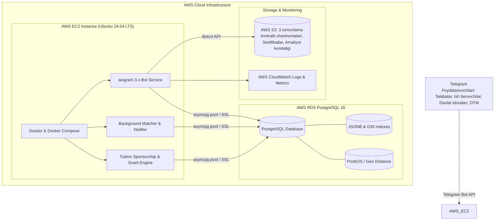

# Kasbdosh — Universal Talaba Ish va Davlat Amaliyoti Birjasi
## Yagona Bosh Hujjat (Master Specification)

> **Loyiha maqsadi:** O'zbekiston OTM talabalari uchun barcha yo'nalishlardagi **tijoriy part-time ishlar** (Ta'lim, Savdo, Media/SMM, Ofis, HoReCa, IT, Gigs), **davlat organlarida rasmiy malakaviy amaliyot/stajirovkalar** (Sudlar, Tibbiyot/Shifoxonalar, Adliya, Hokimlik, Soliq, Maktablar) hamda **davlat va korxonalar tomonidan iqtidorli talabalarning to'lov-kontraktini to'lab berish dasturi (Tuition Sponsorship & Contract Grant)**ni o'z ichiga olgan, **"Oltin Uchburchak" (Soha + Masofa + Vaqt)** asosida ishlovchi universal Telegram bot platformasi.
> **Texnologik stek:** Python 3.11+, aiogram 3.x, **PostgreSQL 16+ (JSONB, GIN indekslar, PostGIS/Earthdistance, asyncpg connection pooling)**, Pydantic v2.
> **Bulutli Infratuzilma:** **AWS (Amazon Web Services)** — AWS EC2 (Dockerized Bot), AWS RDS PostgreSQL (Boshqariladigan baza), AWS S3 (Sertifikatlar, shartnomalar va amaliyot hujjatlari xotirasi).

---

# 1. STRUKTURA VA BULUTLI ARXITEKTURA (AWS & POSTGRESQL)

### 1.1. AWS Bulutli Infratuzilma Arxitekturasi



---

### 1.2. Loyihaning Papkalar Strukturasi (Clean Architecture)

```
kasbdosh/
├── .env.example                     # BOT_TOKEN, DB_HOST, DB_NAME, DB_USER, DB_PASSWORD, AWS_*
├── Dockerfile                       # Python 3.11-slim container
├── docker-compose.yml               # Bot + PostgreSQL (local development uchun)
├── requirements.txt                 # aiogram, asyncpg, pydantic-settings, boto3
├── README.md
│
├── bot/
│   ├── main.py                      # Botni ishga tushirish, dispatcher, fondagi tasklar
│   ├── config.py                    # Pydantic Settings (PostgreSQL & AWS sozlamalari)
│   │
│   ├── core/                        # Tizim yadrosi
│   │   ├── constants.py             # Rollar, kategoriyalar, statuslar enumlari
│   │   ├── roles.py                 # Rol tekshiruvchi middleware va RoleFilter
│   │   ├── middleware.py            # Bloklanganlar filtri, Throttling (antispam), xatolar
│   │   ├── callbacks.py             # CallbackData fabrikalari (st:*, emp:*, adm:*)
│   │   ├── keyboards.py             # Reply/Inline klaviatura generatorlari, Pagination
│   │   └── i18n/                    # Matnlar katalogi
│   │       └── uz.py                # Barcha o'zbekcha matnlar va xabarlar
│   │
│   ├── db/                          # PostgreSQL qatlami (asyncpg)
│   │   ├── connection.py            # asyncpg pool yaratish, SSL, ulanish nazorati
│   │   ├── schema.sql               # PostgreSQL relyatsion sxemasi (DDL)
│   │   └── repositories/            # Asyncpg Repository pattern
│   │       ├── users_repo.py        # Foydalanuvchilar va rollar
│   │       ├── students_repo.py     # Talabalar profili, GPA, kontrakt ma'lumotlari
│   │       ├── employers_repo.py    # Ish beruvchilar va davlat organlari
│   │       ├── jobs_repo.py         # Vakansiyalar va Kontrakt qoplovchi grantlar
│   │       ├── applications_repo.py # Arizalar (FOR UPDATE poygasiz qabul)
│   │       ├── sponsorship_repo.py  # 3 tomonlama kontrakt to'lovi shartnomalari
│   │       ├── internship_repo.py   # Amaliyot kundaligi va ustoz baholari
│   │       ├── ratings_repo.py      # Ikki tomonlama baholash
│   │       └── settings_repo.py     # Tizim konfiguratsiyasi va vaznlar
│   │
│   ├── services/                    # Biznes mantiq (Business Logic)
│   │   ├── matching.py              # Universal "Oltin Uchburchak" saralash algoritmi (100 ball)
│   │   ├── geo.py                   # PostgreSQL spatial/Haversine masofa hisoblagich
│   │   ├── schedule.py              # Dars jadvali to'qnashuvini hisoblovchi yadro
│   │   ├── smart_notifier.py        # 1000 lab e'lon orasidan saralab push beruvchi
│   │   ├── sponsorship_engine.py    # Kuchli kadrlarga kontrakt to'lab berish mexanizmi
│   │   ├── backup_manager.py        # Zaxira nomzodlar (Backup) zanjiri va taymerlar
│   │   ├── s3_service.py            # AWS S3 ga hujjatlarni yuklash (Boto3)
│   │   ├── moderation.py            # Matn va to'lovni avtomatik tahlil qilish
│   │   └── stats.py                 # Real-vaqt dashboard va eksport hisobotlari
│   │
│   └── panels/                      # 3 ta boshqaruv paneli (Handlers)
│       ├── student/                 # 1. TALABA PANELI
│       │   ├── onboarding.py        # Soha, GPA, kontrakt summasi, GPS joylashuv, jadval
│       │   ├── feed.py              # Mos ishlar va "Kontrakt to'lanadigan" grantlar
│       │   ├── applications.py      # Arizalarim, kelgan takliflar
│       │   ├── sponsorship_view.py  # Kontrakt qoplash shartnomalari va statusi
│       │   ├── active_job.py        # Joriy ish/amaliyot, manzil, [Tugatdim]
│       │   ├── profile.py           # Profil, dars jadvalini yangilash, sessiya rejimi
│       │   ├── internship.py        # Elektron amaliyot kundaligi va sertifikat
│       │   └── feedback.py          # Baholash va shikoyat
│       │
│       ├── employer/                # 2. ISH BERUVCHI VA DAVLAT ORGANI PANELI
│       │   ├── onboarding.py        # Tashkilot ro'yxati (Tijoriy / Davlat organi)
│       │   ├── post_job.py          # E'lon joylash (Ish, Amaliyot yoki [🎓 Kontrakt to'lash])
│       │   ├── my_jobs.py           # Vakansiyalar va grantlar boshqaruvi
│       │   ├── inbox.py             # Arizalar (Tanlash, zaxira belgilash, rad etish)
│       │   ├── sponsorship_mgmt.py  # Iqtidorli talabaga kontrakt to'lashni tasdiqlash
│       │   ├── active_jobs.py       # Bugungi ishchi/amaliyotchilar, [No-show]
│       │   ├── internship_eval.py   # Amaliyotchi talabaga rasmiy baho/tavsiyanoma berish
│       │   └── feedback.py          # Talabani baholash
│       │
│       └── admin/                   # 3. ADMIN PANELI (OTM Karyera Markazi bilan)
│           ├── dashboard.py         # Real vaqt statistikasi, bandlik va kontrakt granti monitoringi
│           ├── employers_mod.py     # Tashkilotlarni tekshirib tasdiqlash
│           ├── sponsorship_mod.py   # Kontrakt to'lovi shartnomalarini OTM orqali tasdiqlash
│           ├── jobs_mod.py          # E'lonlar moderatsiyasi
│           ├── students_mgmt.py     # Talabalar nazorati
│           └── export.py            # CSV/Excel eksport (Hakamlar, OTM va ARGOS uchun)
│
└── tests/
    ├── test_matching.py             # Algoritm aniqligi testlari
    ├── test_sponsorship.py         # Kontrakt qoplash mexanizmi testlari
    └── test_schedule_conflict.py    # Dars jadvali to'qnashuvi testlari
```

---

### 1.3. PostgreSQL Relyatsion Sxemasi (PostgreSQL DDL)

```sql
-- Kengaytmalarni yoqish
CREATE EXTENSION IF NOT EXISTS "uuid-ossp";
CREATE EXTENSION IF NOT EXISTS "cube";
CREATE EXTENSION IF NOT EXISTS "earthdistance";

-- ENUM TURLAR
CREATE TYPE user_role AS ENUM ('student', 'employer', 'admin');
CREATE TYPE user_status AS ENUM ('active', 'paused', 'blocked');
CREATE TYPE org_type_enum AS ENUM ('commercial', 'state_agency');
CREATE TYPE listing_type_enum AS ENUM ('paid_job', 'state_internship', 'tuition_grant_job');
CREATE TYPE work_format_enum AS ENUM ('offline_shift', 'remote_task', 'one_day_gig', 'hospital_night_shift');
CREATE TYPE app_status_enum AS ENUM ('pending', 'accepted', 'rejected', 'withdrawn', 'done', 'no_show', 'cancelled');
CREATE TYPE sponsorship_status_enum AS ENUM ('offered', 'student_accepted', 'otm_verified', 'paid', 'rejected');

-- FOYDALANUVCHILAR
CREATE TABLE users (
    id BIGSERIAL PRIMARY KEY,
    tg_id BIGINT UNIQUE NOT NULL,
    role user_role NOT NULL,
    status user_status DEFAULT 'active',
    lang VARCHAR(5) DEFAULT 'uz',
    created_at TIMESTAMPTZ DEFAULT CURRENT_TIMESTAMP,
    last_seen TIMESTAMPTZ DEFAULT CURRENT_TIMESTAMP
);
CREATE INDEX idx_users_tg_id ON users(tg_id);

-- TALABALAR PROFILI
CREATE TABLE students (
    id BIGSERIAL PRIMARY KEY,
    user_id BIGINT UNIQUE REFERENCES users(id) ON DELETE CASCADE,
    full_name VARCHAR(150) NOT NULL,
    faculty VARCHAR(150) NOT NULL,
    major VARCHAR(150) NOT NULL,
    course SMALLINT CHECK(course BETWEEN 1 AND 6) NOT NULL,
    is_contract BOOLEAN DEFAULT TRUE,            -- Kontrakt asosida o'qiydimi
    yearly_tuition_amount INTEGER DEFAULT 0,    -- Yillik kontrakt summasi (so'm)
    gpa_score NUMERIC(3, 2) DEFAULT 0.00,       -- Iqtidorlik ko'rsatkichi (GPA 0.00 - 5.00)
    interests JSONB DEFAULT '[]'::jsonb,         -- Qiziqish teglari
    skills JSONB DEFAULT '[]'::jsonb,            -- Maxsus ko'nikmalar
    location_lat DOUBLE PRECISION,
    location_lon DOUBLE PRECISION,
    location_name VARCHAR(255),
    max_distance_km DOUBLE PRECISION DEFAULT 5.0,
    schedule_busy JSONB DEFAULT '{}'::jsonb,
    buffer_min SMALLINT DEFAULT 45,
    work_formats JSONB DEFAULT '["offline_shift","remote_task","state_internship"]'::jsonb,
    min_pay INTEGER DEFAULT 0,
    transport_cost INTEGER DEFAULT 0,
    trust_score SMALLINT DEFAULT 100,
    is_adult_confirmed BOOLEAN DEFAULT TRUE,
    verified_student BOOLEAN DEFAULT FALSE,
    exam_from DATE,
    exam_to DATE,
    internship_status VARCHAR(20) DEFAULT 'none',
    resume_s3_url VARCHAR(500),
    created_at TIMESTAMPTZ DEFAULT CURRENT_TIMESTAMP
);
CREATE INDEX idx_students_interests_gin ON students USING gin (interests);
CREATE INDEX idx_students_skills_gin ON students USING gin (skills);
CREATE INDEX idx_students_gpa ON students(gpa_score);

-- ISH BERUVCHILAR VA DAVLAT ORGANLARI
CREATE TABLE employers (
    id BIGSERIAL PRIMARY KEY,
    user_id BIGINT UNIQUE REFERENCES users(id) ON DELETE CASCADE,
    company_name VARCHAR(255) NOT NULL,
    org_type org_type_enum NOT NULL,             -- commercial | state_agency
    category VARCHAR(50) NOT NULL,
    address VARCHAR(300) NOT NULL,
    district VARCHAR(100) NOT NULL,
    lat DOUBLE PRECISION,
    lon DOUBLE PRECISION,
    contact_phone VARCHAR(25) NOT NULL,
    contact_person VARCHAR(100) NOT NULL,
    is_verified BOOLEAN DEFAULT FALSE,
    offers_tuition_sponsorship BOOLEAN DEFAULT FALSE, -- Kontrakt to'lab berish imkoniyati bormi
    rating NUMERIC(3, 2) DEFAULT 5.00,
    created_at TIMESTAMPTZ DEFAULT CURRENT_TIMESTAMP
);

-- VAKANSIYALAR, AMALIYOTLAR VA KONTRAKT GRANTLARI
CREATE TABLE jobs (
    id BIGSERIAL PRIMARY KEY,
    employer_id BIGINT REFERENCES employers(id) ON DELETE CASCADE,
    title VARCHAR(200) NOT NULL,
    listing_type listing_type_enum NOT NULL,     -- paid_job | state_internship | tuition_grant_job
    category VARCHAR(50) NOT NULL,
    work_format work_format_enum NOT NULL,
    lat DOUBLE PRECISION,
    lon DOUBLE PRECISION,
    slots_needed SMALLINT DEFAULT 1,
    filled_count SMALLINT DEFAULT 0,
    target_majors JSONB DEFAULT '[]'::jsonb,
    min_course_required SMALLINT DEFAULT 1,
    min_gpa_required NUMERIC(3, 2) DEFAULT 0.00, -- Kontrakt to'lash uchun minimal GPA talabi (masalan 4.0+)
    required_skills JSONB DEFAULT '[]'::jsonb,
    job_date DATE,
    start_time VARCHAR(5),
    end_time VARCHAR(5),
    total_hours NUMERIC(4, 1),
    pay_amount INTEGER DEFAULT 0,
    pay_unit VARCHAR(30) DEFAULT 'per_shift',
    pay_method VARCHAR(20) DEFAULT 'cash',
    pay_timing VARCHAR(30) DEFAULT 'daily',
    -- KONTRAKT TO'LAB BERISH SHARTLARI
    tuition_coverage_percent SMALLINT DEFAULT 0, -- 100% yoki 50% kontrakt qoplanadi
    work_obligation_years SMALLINT DEFAULT 0,    -- Ishlab berish majburiyati (masalan 1-2 yil)
    duties JSONB NOT NULL,
    perks JSONB DEFAULT '[]'::jsonb,             -- ["kontrakt_qoplash", "amaliyot_muhri", "tushlik"]
    is_urgent BOOLEAN DEFAULT FALSE,
    status VARCHAR(20) DEFAULT 'open',
    created_at TIMESTAMPTZ DEFAULT CURRENT_TIMESTAMP
);
CREATE INDEX idx_jobs_target_majors_gin ON jobs USING gin (target_majors);

-- ARIZALAR VA ZAXIRA NOMZODLAR
CREATE TABLE applications (
    id BIGSERIAL PRIMARY KEY,
    job_id BIGINT REFERENCES jobs(id) ON DELETE CASCADE,
    student_id BIGINT REFERENCES students(id) ON DELETE CASCADE,
    match_score NUMERIC(5, 2) NOT NULL,
    is_backup BOOLEAN DEFAULT FALSE,
    backup_rank SMALLINT DEFAULT 0,
    status app_status_enum DEFAULT 'pending',
    reject_reason VARCHAR(255),
    student_confirmed_at TIMESTAMPTZ,
    employer_confirmed_at TIMESTAMPTZ,
    created_at TIMESTAMPTZ DEFAULT CURRENT_TIMESTAMP,
    CONSTRAINT uq_job_student UNIQUE (job_id, student_id)
);

-- UCH TOMONLAMA KONTRAKT TO'LASH SHARTNOMALARI (TALABA - ISH BERUVCHI - OTM)
CREATE TABLE tuition_sponsorships (
    id BIGSERIAL PRIMARY KEY,
    application_id BIGINT REFERENCES applications(id) ON DELETE CASCADE,
    student_id BIGINT REFERENCES students(id) ON DELETE CASCADE,
    employer_id BIGINT REFERENCES employers(id) ON DELETE CASCADE,
    covered_amount INTEGER NOT NULL,             -- To'lab beriladigan summa (so'm)
    obligation_months SMALLINT NOT NULL,         -- Ishlab berish muddati (oy)
    contract_pdf_s3_url VARCHAR(500),            -- AWS S3 dagi 3 tomonlama shartnoma
    status sponsorship_status_enum DEFAULT 'offered',
    otm_approved_by VARCHAR(100),                -- OTM rektorat tasdig'i
    otm_approved_at TIMESTAMPTZ,
    created_at TIMESTAMPTZ DEFAULT CURRENT_TIMESTAMP
);

-- AMALIYOT KUNDALIGI VA BAHOLAR
CREATE TABLE internship_logs (
    id BIGSERIAL PRIMARY KEY,
    application_id BIGINT REFERENCES applications(id) ON DELETE CASCADE,
    student_id BIGINT REFERENCES students(id) ON DELETE CASCADE,
    visit_date DATE NOT NULL,
    hours_spent NUMERIC(4, 1) NOT NULL,
    tasks_performed TEXT NOT NULL,
    mentor_feedback TEXT,
    mentor_score SMALLINT CHECK(mentor_score BETWEEN 1 AND 5),
    verified_by_mentor BOOLEAN DEFAULT FALSE,
    certificate_s3_url VARCHAR(500),
    created_at TIMESTAMPTZ DEFAULT CURRENT_TIMESTAMP
);

CREATE TABLE ratings (
    id BIGSERIAL PRIMARY KEY,
    job_id BIGINT REFERENCES jobs(id) ON DELETE CASCADE,
    from_user_id BIGINT REFERENCES users(id),
    to_user_id BIGINT REFERENCES users(id),
    role VARCHAR(30) NOT NULL,
    score SMALLINT CHECK(score BETWEEN 1 AND 5) NOT NULL,
    tags JSONB DEFAULT '[]'::jsonb,
    comment TEXT,
    created_at TIMESTAMPTZ DEFAULT CURRENT_TIMESTAMP
);

CREATE TABLE audit_logs (
    id BIGSERIAL PRIMARY KEY,
    actor_id BIGINT REFERENCES users(id),
    action VARCHAR(100) NOT NULL,
    target_type VARCHAR(50) NOT NULL,
    target_id BIGINT NOT NULL,
    details JSONB,
    created_at TIMESTAMPTZ DEFAULT CURRENT_TIMESTAMP
);

CREATE TABLE settings (
    key VARCHAR(100) PRIMARY KEY,
    value JSONB NOT NULL,
    updated_at TIMESTAMPTZ DEFAULT CURRENT_TIMESTAMP
);
```

---

# 2. TO'LIQ LOYIHA ISHLASHI VA KONTRAKT QOPLASH DASTURI

### 2.1. Hukumat Qarori Asosida: "Kuchli Kadrlarga Kontrakt To'lab Berish" Mexanizmi

O'zbekiston Respublikasi qonunchiligi (Soliq kodeksining 378-moddasi, Prezident va Hukumatning yoshlar bandligi hamda davlat organlariga iqtidorli yoshlarni jalb qilish bo'yicha qarorlari)ga asosan:
* **Davlat organi yoki Korxona** o'ziga zarur bo'lgan kuchli va iqtidorli talabani (GPA $\ge 4.0$, "Kasbdosh" platformasida reytingi yuqori, amaliyotda o'zini ko'rsatgan) ishga olganda, uning **yillik to'lov-kontraktini to'liq yoki 50% gacha to'lab berish** huquqiga ega.
* **Soliq Imtiyozi:** Ish beruvchi tashkilot tomonidan talabaning kontraktiga o'tkazilgan mablag'lar foyda solig'idan chegiriladi va jismoniy shaxs daromad solig'idan ozod etiladi!
* **Uch tomonlama kafolat (Talaba — Ish beruvchi — OTM):** Talaba o'qishini tamomlagach ushbu tashkilotda kelishilgan muddatda (masalan 1–2 yil) ishlab beradi, tashkilot esa kontraktni to'g'ridan-to'g'ri OTM hisob raqamiga o'tkazib beradi.

```
┌─────────────────┐       1. Iqtidorli nomzodni tanlash       ┌──────────────────────┐
│  Davlat Organi  │──────────────────────────────────────────▶│   Iqtidorli Talaba   │
│   yoki Korxona  │◀──────────────────────────────────────────│ (GPA 4.5+, Kasbdosh) │
└────────┬────────┘       2. Ishlashga rozilik bildirish       └──────────┬───────────┘
         │                                                                │
         │ 3. Yillik kontraktni to'lab berish                             │
         │    (Soliq imtiyozi bilan)                                      │ 4. 3 tomonlama
         ▼                                                                │    shartnoma
┌─────────────────────────────────────────────────────────────┐           │
│                     OTM / Universitet                       │◀──────────┘
│            (Talabani kadr sifatida tayyorlab beradi)        │
└─────────────────────────────────────────────────────────────┘
```

---

### 2.2. "Oltin Uchburchak" Tamoyili (The Golden Triangle)

Talabaning har qanday ish, amaliyot yoki kontrakt granti topishida 3 ta asosiy ustun ta'minlanadi:
1. **Soha, Iqtidor va Qiziqish (35 ball):** Talaba OTM mutaxassisligi, GPA ko'rsatkichi va qiziqish teglari (SMM, repetitorlik, sud kotibi, IT) bo'yicha saralanadi. GPA $\ge 4.0$ bo'lgan iqtidorli talabalarga "Kontrakt to'lab beriladigan" e'lonlar birinchi bo'lib chiqadi.
2. **Oraliq Masofa va Joylashuv (25 ball):** Telegram orqali yuborilgan GPS koordinata bo'yicha PostgreSQL'ning `earth_distance` funksiyasi yordamida radius hisoblanadi (piyoda $\le 1.5$ km yoki $\le 5$ km).
3. **Qulay Vaqt va Dars Jadvali (25 ball):** OTM dars soatlari (UrDU juftliklari) qat'iy nazorat qilinadi. Dars paytidagi ishlar talabaga mutlaqo ko'rinmaydi. Darsdan keyin kamida 45 daqiqa yo'l zaxirasi qoldiriladi.

---

### 2.3. Tizimning 3 ta Asosiy Yo'nalishi

| Yo'nalish | Kimlar uchun? | To'lov / Rag'bat | Natija |
|---|---|---|---|
| **1. Tijoriy Part-time** | Erkin grafikda pul topmoqchi bo'lgan barcha talabalar | Soatbay / Smena / Kunlik naqd yoki karta | Mustaqil kunlik daromad |
| **2. Davlat Amaliyoti** | Tibbiyot, Sud/Huquq, Adliya, Hokimlik, Soliq talabalari | Amaliyot kundaligi tasdig'i, tavsiyanoma | ARGOS (`vacancy.argos.uz`) kadrlar zaxirasi |
| **3. Kontrakt To'lovi Granti** | GPA yuqori bo'lgan kuchli, iqtidorli talabalar | **Yillik kontrakt 100% yoki 50% to'lab beriladi** | OTM kontraktidan qutulish + Kafolatlangan ish o'rni |

---

### 2.4. Smart Bildirishnoma (Anti-Spam Push Engine)

Kuniga **1000 lab vakansiya va grantlar** kiritilsa ham, talabani spam qilmaslik mexanizmi:
* **Event-Driven Filtering:** Yangi e'lon tushishi bilan `smart_notifier.py` fonda ishga tushadi: dars soati to'qnashmagan, masofasi mos va mutaxassisligi to'g'ri kelgan nomzodlarni PostgreSQL GIN indeksi orqali millisekundda saralaydi.
* **Minimal Chegara Balli ($\ge 75\%$):** Shaxsiy bildirishnoma faqat moslik balli 75% dan oshgan talabalargagina boradi.
* **Tinch Soatlar (22:00–08:00):** Tunda bildirishnomalar to'xtatiladi.

#### Kontrakt Qoplash Bildirishnomasi Namunasi:
```
🎓 Sizga KONTRAKT TO'LAB BERILADIGAN vakansiya taklifi! (Moslik: 98%)

🏢 Tashkilot: Xorazm Viloyati Adliya Boshqarmasi
💼 Lavozim: Yuridik maslahatchi yordamchisi (0.5 stavka)
📍 Manzil: Urganch sh., Mustaqillik ko'chasi
📏 Masofa: 1.8 km (Universitetdan 10 daqiqa)
⏰ Vaqti: Dushanba-Juma (15:00 – 18:00) (Darsingizdan keyin)

🎁 MAXSUS IMTIYOZ (Hukumat Qaroriga Asosan):
✔ Yillik to'lov-kontrakt 100% to'lab beriladi!
✔ O'qishni tugatgach 1.5 yil ishlab berish sharti bilan
✔ Rasmiy staj yoziladi + oylik maosh

💡 Nega aynan siz:
✔ Yurisprudensiya 3-kurs talabasisiz (+35)
✔ GPA ko'rsatkichingiz 4.6 (talab: 4.0+) (+20)
✔ Dars jadvalingiz to'liq mos keladi (+25)
✔ 2 km radius ichidasiz (+18)

[ 📝 Kontrakt grantiga topshirish ]   [ ℹ️ Shartnoma namunasi ]
```

---

# 3. PANELLAR VA FUNKSIYALAR

### 3.1. TALABA PANELI (Student)
* **Doimiy Menyu (ReplyKeyboard):**
  ```
  [ 🎯 Mos ishlar & Amaliyotlar ]   [ 🎓 Kontrakt to'lanadigan ishlar ]
  [ 💼 Joriy ish / Amaliyotim ]     [ 📨 Arizalarim & Takliflar ]
  [ 📍 Joylashuv & Radius ]        [ 👤 Profil, GPA & Kontrakt ]
  [ 📜 Amaliyot kundaligi ]         [ 📚 Sessiya rejimi ]
  ```
* **Profilida:** GPA bali, kontrakt summasi, mutaxassisligi va dars jadvali saqlanadi.
* **Kontrakt Granti Oqimi:** Ish beruvchi taklifini qabul qilgach, bot avtomatik ravishda OTM, Talaba va Tashkilot o'rtasidagi 3 tomonlama shartnoma qoralamasini (PDF) tayyorlab beradi.

### 3.2. ISH BERUVCHI VA DAVLAT ORGANI PANELI (Employer / State Agency)
* **Doimiy Menyu (ReplyKeyboard):**
  ```
  [ ➕ Yangi e'lon / Kvota joylash ] [ 📋 Ochiq e'lonlarim ]
  [ 👥 Nomzodlar (GPA filtri bilan) ][ 🎓 Kontrakt granti berilganlar ]
  [ 📅 Bugungi xodimlar ]            [ ✍️ Amaliyot / Sertifikat tasdiqlash ]
  [ 🏢 Muassasa profili ]            [ 🆘 Yordam ]
  ```
* **E'lon kiritishda:** `[✅ Ushbu kadrning kontraktini to'lab beramiz]` opsiyasi tanlanadi (100% yoki 50%, ishlab berish muddati bilan).

### 3.3. ADMIN PANELI (OTM Karyera Markazi va Rektorat bilan)
* **Doimiy Menyu (ReplyKeyboard):**
  ```
  [ 📊 Dashboard (Bandlik va Kontrakt) ] [ 🏛 Tashkilotlarni tekshirish ]
  [ 🎓 Kontrakt to'lovlarini tasdiqlash] [ 📋 E'lonlar nazorati ]
  [ ⚠️ Shikoyatlar va Nizolar ]         [ 📤 Rasmiy hisobot (OTM / ARGOS) ]
  ```

---

# 4. AMALGA OSHIRISH VA AWS DEPLOYMENT REJASI (P0 – P5)

* **P0 — PostgreSQL va AWS Konfiguratsiyasi (1.5 soat):** Baza DDL (kontrakt grantlari va GPA maydonlari bilan), `asyncpg` ulanish pooli, AWS S3 integratsiyasi.
* **P1 — Talaba Paneli va Dars Jadvali (2 soat):** GPA kiritish, GPS lokatsiya, dars jadvali filtri, mos ishlar va kontrakt grantlari lentasi.
* **P2 — Ish Beruvchi va Davlat Organi Paneli (2 soat):** Kontrakt to'lab berish shartlari bilan vakansiya kiritish, nomzodlarni saralash (`FOR UPDATE` poygasiz tranzaksiya).
* **P3 — Zaxira Nomzod va Smart Bildirishnoma (1.5 soat):** Zaxira nomzodlar zanjiri, yuqori GPA talabalarga kontrakt taklifi push xabari.
* **P4 — Elektron Amaliyot Kundaligi va 3 tomonlama Shartnoma (1.5 soat):** S3 ga PDF yuklash, amaliyot kundaligi, admin dashboard va eksport.
* **P5 — Docker, AWS EC2 Deployment va Demo (1 soat):** AWS EC2 ga deploy qilish, 15 ta talaba bilan to'liq ssenariyni sinash.